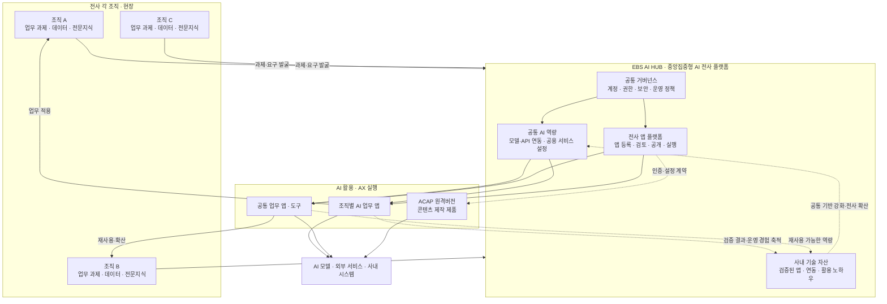

# EBS AI HUB 소개 자료

> **한 줄 소개**
> EBS AI HUB는 회사의 AI 기술력과 공통 AI 역량을 중앙에 축적하고, 전사 각 조직의 AX를 유기적으로 연결·확산하는 중앙집중형 AI 전사 플랫폼입니다.

## 1. 소개

AI HUB는 회사가 AI 기술력과 공통 기반을 직접 축적하고, 이를 전사 업무에 반복해서 활용할 수 있도록 하는 중앙집중형 AI 전사 플랫폼입니다. 공통 AI 모델·서비스 연동, 운영 정책, 계정과 권한, 앱 카탈로그를 플랫폼에서 관리하고 각 조직은 자기 업무에 맞는 앱과 AX 과제를 연결합니다. 사용자는 하나의 계정으로 로그인해 자신에게 공개된 AI·업무 앱을 이용하고, 관리자는 조직의 AI 활용 기반과 앱 제공 체계를 운영합니다.

핵심은 중앙의 기술 역량을 전사에 일괄 강요하는 것이 아니라, 공통 기반과 관리 원칙은 중앙에서 확보하고 현장의 업무 지식과 개선 과제는 각 조직에서 발굴하는 구조입니다. 검증된 모델·연동·앱을 공통 자산으로 축적하고 필요한 조직이 재사용하면 기술 중복을 줄이고 AX 성과를 조직 간에 확산할 수 있습니다. 데이터는 업무·보안 요건에 따라 적절히 관리하며, 중앙집중형 플랫폼을 모든 데이터를 한곳에 복제하는 구조로 단정하지 않습니다.

## 2. 해결하려는 문제

- AI 도입이 개인·부서별 실험에 머물면 기술과 경험이 조직의 자산으로 쌓이지 않습니다.
- 같은 기반을 조직마다 따로 구축하면 비용과 운영 부담이 커지고, 성과와 노하우를 공유하기 어렵습니다.
- 조직별 데이터·업무 절차와 공통 AI 정책을 함께 고려할 통합 운영 기반이 필요합니다.
- 각 현장의 AX 과제를 안전하게 발굴하고, 검증된 해결책을 다른 조직으로 확산할 연결 구조가 필요합니다.

## 3. 제품 콘셉트

### 중앙 AI 기반, 전사 업무 적용

AI HUB가 공통 AI 기술·연결·운영 정책을 제공하고, 각 조직은 이를 활용해 부서와 직무에 필요한 AX 앱과 업무 흐름을 만듭니다. 중앙에서 검증된 역량을 전사에 재사용할 수 있도록 합니다.

### 사내 기술력의 축적

공통 모델·API 연동, 앱 구성요소, 운영 경험과 검증된 활용 방식을 플랫폼의 재사용 가능한 자산으로 축적합니다. 장기적으로 외부 서비스에 대한 단순 의존을 넘어 회사가 AI를 설계·운영·개선하는 역량을 키우는 기반이 됩니다.

### 중앙 거버넌스와 현장 자율성

공통 로그인·권한·보안·서비스 설정과 앱 공개 기준은 중앙에서 관리합니다. 각 조직은 공통 기준 안에서 실제 업무 문제를 정의하고, 필요한 AI 적용 방식을 제안·사용합니다.

### AX 과제의 유기적 확산

개별 조직의 문제 해결 경험을 앱과 운영 지식으로 구체화해 공유하고, 유사한 업무를 가진 다른 조직이 다시 활용하도록 연결합니다. 이렇게 현장의 AX가 공통 기술 역량을 강화하고, 강화된 역량이 다음 AX 과제를 돕는 선순환을 지향합니다.

## 4. 개념도

### 구조 읽는 법

1. 각 조직은 업무 문제와 AX 과제를 정의하고 필요한 요구를 제안합니다.
2. **AI HUB**는 공통 계정·권한·운영 정책과 AI 연동 기반을 중앙에서 관리합니다.
3. 조직의 업무 요구는 앱으로 구현되고, 검토·공개 절차를 거쳐 필요한 사용자에게 제공됩니다.
4. 앱과 AI 역량이 실제 업무에 적용되면서 검증된 연동·앱·운영 경험이 공통 자산으로 축적됩니다.
5. 축적된 자산은 다른 조직의 AX 과제에 재사용되어 전사 확산을 돕습니다.
6. **ACAP 원격버전**은 별도 콘텐츠 제작 제품입니다. AI HUB의 인증·설정 계약을 이용해 연결될 수 있지만, 제작 화면과 제작 데이터는 ACAP이 담당합니다.

## 5. 주요 사용자 경험

### 일반 사용자

- 계정을 만들고 조직 관리자의 승인을 받습니다.
- 나에게 공개된 앱을 마켓플레이스에서 확인합니다.
- 필요한 앱을 설치하고 대시보드에 배치해 실행합니다.
- 캘린더, 할 일, 메모, 메시지, AI 도구 등 업무 앱을 작업 공간에서 이용합니다.

### 관리자

- 가입 대기 사용자와 승인 상태를 관리합니다.
- 사용자 역할과 그룹, 앱 접근 권한을 관리합니다.
- 앱을 등록·검토하고 공개 대상을 정합니다.
- 공통 서비스 연결과 플랫폼 운영 설정을 관리합니다.

### 앱 개발자

- 개발자 가이드와 스타터 킷을 바탕으로 앱을 제작합니다.
- 앱을 플랫폼 카탈로그에 제출해 검토를 받을 수 있습니다.
- 공개된 앱은 AI HUB의 앱 실행 환경과 사용자 접근 체계를 통해 제공됩니다.

## 6. 현재 확인되는 기능 예시

내장 앱 레지스트리에는 다음과 같은 앱이 포함되어 있습니다.

| 영역 | 앱 예시 |
| --- | --- |
| AI 업무 | 나만의 LLM, 메일 생성기, 음성 요약, Codex |
| 일상 업무 | 캘린더, 할 일, 메시지, 메모, 바로가기 |
| 조직 업무 | 재물조사 |
| 앱 확장 | 관리자 검토·공개 후 제공되는 원격 앱 |

실제 사용자에게 보이는 앱과 기능은 계정 권한, 공개 설정, 운영 환경에 따라 달라집니다.

## 7. 핵심 가치

| 가치 | 설명 |
| --- | --- |
| **사내 AI 기술력 확보** | AI 도입 경험과 공통 연동·운영 역량을 회사의 재사용 가능한 자산으로 축적합니다. |
| **전사 공통 기반** | 계정·권한·보안·AI 서비스 연결을 공통 플랫폼에서 관리합니다. |
| **현장 중심 AX** | 각 조직이 업무 문제를 바탕으로 실질적인 AI 활용 과제를 발굴합니다. |
| **유기적 확산** | 검증된 앱과 노하우를 다른 조직이 다시 활용해 성과를 넓힙니다. |
| **중앙 관리와 업무 유연성** | 공통 원칙은 중앙에서 지키고, 업무 적용은 조직의 맥락에 맞게 설계합니다. |

## 8. 소개 발표 구성안

### 5장 구성

1. **문제 제기** — 부서별 AI 실험이 회사의 기술력과 전사 성과로 이어지지 않는 문제
2. **EBS AI HUB 소개** — 회사의 공통 AI 역량을 축적하는 중앙집중형 AI 전사 플랫폼
3. **개념도** — 현장 과제 → 중앙 AI 기반과 거버넌스 → 업무 앱 적용 → 사내 자산 축적·확산
4. **운영 모델** — 중앙의 공통 기반·관리와 현장 조직의 과제 발굴·업무 적용
5. **확장 방향** — 성과와 기술 자산을 재사용해 전사 AX를 지속적으로 확장

### 60초 소개 문안

> EBS AI HUB는 회사의 AI 기술력을 확보하고 전사 AX를 유기적으로 추진하기 위한 중앙집중형 AI 전사 플랫폼입니다. 공통 AI 연동과 운영 정책, 계정과 권한, 앱 제공 기반을 중앙에서 관리하고 각 조직은 자기 업무의 문제를 AI 과제로 발전시킵니다. 현장에서 검증된 앱과 활용 경험은 회사의 기술 자산으로 쌓이고, 다른 조직이 다시 활용하면서 AX 성과가 확산됩니다. AI HUB는 중앙의 기술 기반과 현장의 업무 혁신을 연결해 회사 전체의 AI 역량을 키워갑니다.

## 9. 메시지와 시각 콘셉트

### 권장 슬로건

**회사의 AI 역량을 모아, 전사의 AX로.**

보조 문구: **중앙의 AI 기술력과 현장의 업무 혁신을 연결하는 전사 플랫폼**

### 시각 방향

- **중앙 AI 코어**: 중앙에는 공통 AI 기반과 거버넌스를 두고 전사 조직·업무 앱으로 역량이 흐르는 모습을 표현합니다.
- **현장과 중앙의 양방향 연결**: 각 조직의 과제가 중앙 플랫폼으로 모이고, 검증된 기반·앱·노하우가 조직으로 다시 확산되는 흐름을 강조합니다.
- **축적되는 사내 기술 자산**: 한 번 해결한 AX 과제가 앱·연동·운영 지식으로 쌓여 다음 조직의 출발점이 되는 구조를 시각화합니다.
- **중앙 관리와 현장 적용**: 중앙 쪽은 공통 AI·보안·운영 정책으로, 현장 쪽은 업무 과제·전문지식·성과로 표현합니다.
- **보라색 계열 포인트**: AI와 연결의 인상을 주는 포인트 컬러로 활용하고, 본문은 밝고 단정하게 유지합니다.
- 실제 기능 화면을 활용할 때는 사용자 정보, 이메일, API 키 등 민감 정보가 보이지 않도록 샘플 데이터로 촬영합니다.

## 10. 설명 시 유의할 점

- AI HUB는 **AI 모델 하나나 앱 목록 화면만을 뜻하지 않습니다.** 회사가 공통 AI 역량과 운영 기반을 확보하고, 이를 전사 업무에 적용하도록 연결하는 플랫폼 비전입니다.
- AI 기능의 제공 범위, 사용 모델, 비용, 데이터 보관 방식은 앱과 연결된 서비스의 설정을 확인해 안내합니다.
- ACAP은 AI HUB의 제작 화면이 아닙니다. AI HUB는 공통 플랫폼을, ACAP 원격버전은 콘텐츠 제작 경험을 담당합니다.
- 기능을 소개할 때는 현재 공개 설정과 실제 사용 권한에 따라 앱 목록과 동작이 달라질 수 있음을 함께 설명합니다.
